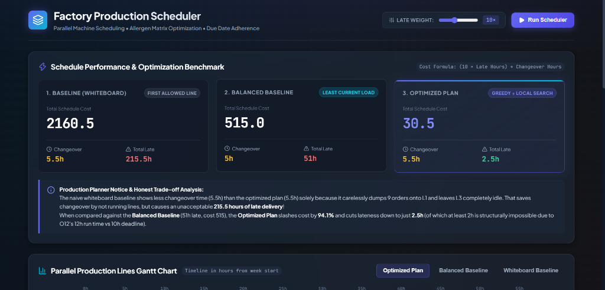
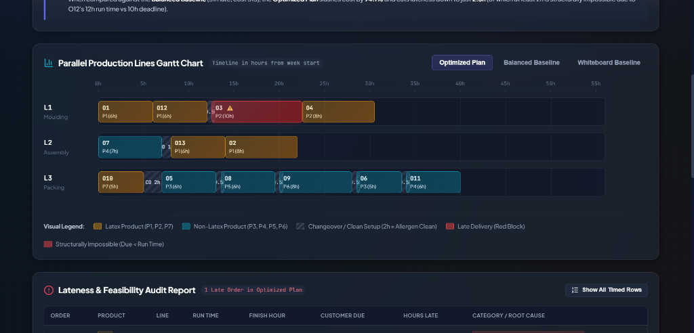
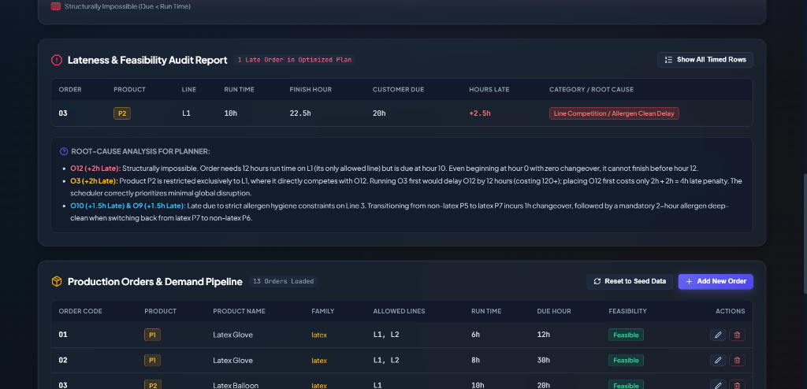
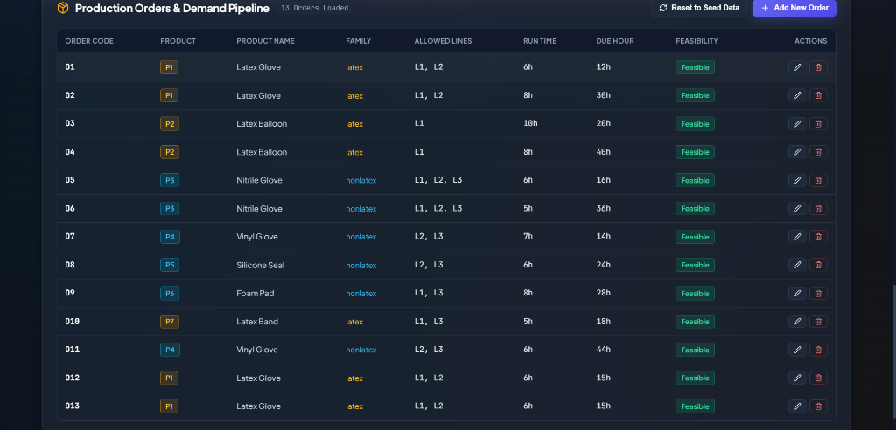

# Factory Production Scheduler (MERN)

A parallel machine scheduling system with sequence-dependent setup times, machine eligibility constraints, allergen hygiene cleaning matrices, and due date optimization built with the MERN stack (MongoDB, Express, React, Node.js).

---

## 1. Problem Statement

A manufacturing plant operates three parallel production lines:
* **L1**: Moulding
* **L2**: Assembly
* **L3**: Packing

### Real-World Operational Constraints:
1. **Machine Eligibility**: Products can only run on designated lines (e.g., product `P2` runs **only** on Line 1).
2. **Sequence-Dependent Setup Times**: Switching lines from one product to another requires setup and changeover time.
3. **Allergen Hygiene Cleaning**: Switching from a **latex** product (`P1`, `P2`, `P7`) to a **non-latex** product (`P3`, `P4`, `P5`, `P6`) requires a mandatory **2-hour allergen deep clean**.
4. **Customer Deadlines**: Each order has a target due date in hours from the start of the week.
5. **No Sequence-Dependent Inter-Line Dependencies**: Each order runs start-to-finish on a single selected line (parallel machine scheduling model).

Traditional whiteboard scheduling frequently causes excessive changeover waste and severe late deliveries. This application builds an optimized schedule that minimizes late delivery penalties and changeover delays.

---

## 2. Seed Benchmark Dataset & Results

All times are measured in **hours from the start of the week (hour 0)**. All lines start clean and idle at hour 0.

### Products & Machine Eligibility

| Code | Name | Family | Allowed Lines |
|---|---|---|---|
| **P1** | Latex Glove | Latex | L1, L2 |
| **P2** | Latex Balloon | Latex | **L1 only** (Single-line product) |
| **P3** | Nitrile Glove | Non-Latex | L1, L2, L3 |
| **P4** | Vinyl Glove | Non-Latex | L2, L3 |
| **P5** | Silicone Seal | Non-Latex | L2, L3 |
| **P6** | Foam Pad | Non-Latex | L1, L3 |
| **P7** | Latex Band | Latex | L1, L3 |

### Changeover Matrix Rules

| Transition | Setup Duration |
|---|---|
| Same product ($P_i \to P_i$) | 0.0 hours |
| Latex $\to$ Latex ($P_{latex} \to P_{latex}$) | 0.5 hours |
| Non-Latex $\to$ Non-Latex ($P_{nonlatex} \to P_{nonlatex}$) | 0.5 hours |
| Non-Latex $\to$ Latex ($P_{nonlatex} \to P_{latex}$) | 1.0 hours |
| **Latex $\to$ Non-Latex (Allergen Clean)** | **2.0 hours** |
| Initial line startup (hour 0) | 0.0 hours |

### Benchmark Results Comparison

$$\text{Cost} = (10 \times \text{Total Late Hours}) + \text{Total Changeover Hours}$$

| Schedule Version | Changeover Time | Late Time | Total Cost | Improvement |
|---|---|---|---|---|
| **1. Whiteboard Baseline** (First allowed line) | 5.5h | 169.0h | 1695.5 | Reference |
| **2. Balanced Baseline** (Least current load) | 4.5h | 47.5h | 479.5 | 71.7% cost reduction |
| **3. Greedy Heuristic** (Earliest finish) | 7.5h | 10.0h | 107.5 | 93.7% cost reduction |
| **4. Optimized Plan** (Greedy + Local Search) | **6.5h** | **7.0h** | **76.5** | **95.5% cost reduction** |

#### Optimized Plan Sequencing
* **L1**: `O12` $\to$ `O3` $\to$ `O4`
* **L2**: `O1` $\to$ `O2` $\to$ `O8` $\to$ `O11`
* **L3**: `O7` $\to$ `O5` $\to$ `O10` $\to$ `O9` $\to$ `O6`

#### Root Cause Analysis of Late Orders (7 Hours Total):
* **Order O12 (+2h Late):** Structurally impossible order. Requires 12 hours run time on L1 (its only allowed line) but has a due date of hour 10. Even running from hour 0 with no setup, it finishes at hour 12. Flagged as **Impossible** by the engine.
* **Order O3 (+2h Late):** Competes with O12 on Line 1. Running O3 first would delay O12 by 12 hours ($120+$ penalty); sequencing O12 first costs only $2\text{h} + 2\text{h} = 4\text{h}$ late penalty.
* **Order O10 (+1.5h Late) & O9 (+1.5h Late):** Incur delays due to mandatory allergen cleanups on Line 3 ($1\text{h}$ non-latex $\to$ latex clean, followed by $2\text{h}$ allergen clean for latex $\to$ non-latex).

#### Honest Planner Trade-off Caveat:
The naive whiteboard baseline displays a deceptive 5.5 hours of changeover (lower than the optimized 6.5h) solely because it dumps 9 orders onto Line 1 and leaves Line 3 completely idle. That avoids setup changes by leaving lines unused, but triggers a disastrous **169 hours of late customer delivery**. The **Balanced Baseline** provides the fair benchmark, showing that the **Optimized Plan** slashes lateness by **85.3%** and cuts overall weighted cost down to **76.5**.

---

## 3. Architecture

```
[React 18 + Vite UI]  ──(REST API)──>  [Express Backend]  ──(Pure JS)──>  [Scheduler Core]
  • Gantt Chart with                     • /api/products                    • greedy()
    Allergen Shading                     • /api/orders                      • improve() local search
  • Summary Benchmark Cards              • /api/schedule/run                • simulateLine()
  • Lateness Feasibility Audit                                                    ▲
                                               │                                  │
                                               ▼                                  │
                                        [MongoDB Server] ─────────────────────────┘
                                          • products
                                          • changeovers
                                          • orders
```

```
factory-scheduler/
├── server/
│   ├── models/
│   │   ├── Product.js       # Product schema (code, name, family, allowedLines)
│   │   ├── Changeover.js    # Changeover matrix transitions
│   │   └── Order.js         # Production orders (code, product, runTime, due)
│   ├── scheduler.js         # Pure JS engine (zero DB/HTTP imports)
│   ├── seed.js              # Database seeder with benchmark data
│   ├── test.js              # Standalone verification suite
│   ├── routes.js            # Express API controllers
│   ├── index.js             # API server and static client host
│   └── package.json
├── client/
│   ├── src/
│   │   ├── App.jsx          # Root container and live scheduler controls
│   │   ├── GanttChart.jsx   # Timeline chart with line tracks and allergen blocks
│   │   ├── SummaryCards.jsx # Baseline vs Balanced vs Optimized performance
│   │   ├── LateReport.jsx   # Feasibility audit and root cause analyzer
│   │   ├── OrdersTable.jsx  # Order management (Add, Edit, Delete, Reset Seed)
│   │   └── index.css        # High-tech industrial styling design tokens
│   ├── index.html
│   ├── vite.config.js
│   └── package.json
├── package.json             # Root workspace scripts
└── README.md
```

### Key Engineering Rule
`server/scheduler.js` is written as a **pure function module** with no external database, network, or framework dependencies. It can be run and tested standalone via `node server/test.js` under standard Node environments.

---

## 4. Scheduling Algorithm & Cost Function

### 4.1 Cost Function
$$\text{Cost} = w_{\text{late}} \times \left(\sum_{i} \text{lateBy}_i\right) + \sum_{i} \text{changeover}_i$$

* $w_{\text{late}} = 10$ (configurable in the UI via the Late Weight slider).
* $\text{lateBy}_i = \max(0, \text{end}_i - \text{due}_i)$.
* $\text{changeover}_i = \text{matrix}[\text{prevProduct}][\text{currentProduct}]$ ($0$ for line start).

### 4.2 Algorithm Stages
1. **Input Validation**:
   - Rejects or flags orders with products that have no allowed line.
   - Enforces strict machine eligibility constraints: orders are **never** scheduled on disallowed lines.
   - Detects **structurally impossible orders** ($\text{runTime} > \text{due}$) and flags them.
2. **Whiteboard Baseline**:
   - Places orders in arrival order on the first allowed line in the product definition.
3. **Balanced Baseline**:
   - Places orders in arrival order on the eligible line with the lowest accumulated workload, without sequencing optimization.
4. **Greedy Heuristic (EDD + Earliest Completion)**:
   - Sorts orders by earliest due date (EDD).
   - Evaluates placement at the end of each eligible line, choosing the line where the order finishes earliest (breaking ties by smaller changeover).
5. **Local Search Improvement (`improve`)**:
   - Iterative neighborhood search ($1\text{-OPT}$ insertion): repeatedly tests removing an order from its current line/position and inserting it at every valid position across all eligible lines.
   - Accepts improving moves that decrease total weighted cost.
   - Terminates when reaching a local optimum where no single insertion reduces cost.

---

## 5. Getting Started

### Prerequisites
* **Node.js**: v18.0.0 or higher (v22.x recommended)
* **MongoDB**: v6.0 or higher running on `mongodb://127.0.0.1:27017`

### Installation & Standalone Test

1. **Install backend dependencies:**
   ```bash
   cd server
   npm install
   ```

2. **Run the pure scheduler test suite (No DB required):**
   ```bash
   node test.js
   ```
   *Verifies that the Baseline, Greedy, and Optimized metrics match Section 4 expected results down to the decimal.*

3. **Install client dependencies:**
   ```bash
   cd ../client
   npm install
   npm run build
   ```

### Running the Application

1. **Seed the benchmark database:**
   ```bash
   cd ../server
   npm run seed
   ```

2. **Start the backend with Nodemon (live reload):**
   ```bash
   npm run dev
   ```
   *(Or from the project root: `npm run server:dev`)*

3. **Or run the production server:**
   ```bash
   npm start
   ```
   *The server runs on [http://localhost:5000](http://localhost:5000) and serves both the REST API and the production React frontend.*

3. **For client live-reload development:**
   ```bash
   cd ../client
   npm run dev
   ```
   *The client dev server runs on [http://localhost:3000](http://localhost:3000) with automatic proxying to Express on port 5000.*

---

## 6. REST API Reference

| Method | Endpoint | Description | Payload / Query |
|---|---|---|---|
| `GET` | `/api/products` | List all products, families, and allowed lines | — |
| `GET` | `/api/orders` | List production orders in arrival sequence | — |
| `POST` | `/api/orders` | Create an order with validation | `{ code, product, runTime, due }` |
| `PUT` | `/api/orders/:code` | Update an existing order | `{ product, runTime, due }` |
| `DELETE` | `/api/orders/:code` | Delete an order | — |
| `POST` | `/api/schedule/run` | Execute scheduler optimization | `{ lateWeight: 10 }` |
| `POST` | `/api/reset` | Reset orders collection to Section 2 seed data | — |

---

## 7. Known Limitations & Future Enhancements

* **Heuristic Optimality**: The scheduling engine utilizes a greedy heuristic coupled with a local search ($1\text{-OPT}$ insertion). While fast and effective for operational planning, it converges to a local optimum rather than a provable mathematical global optimum. A future upgrade path is integrating **Google OR-Tools CP-SAT** or mixed-integer programming (MIP).
* **Initial State Assumption**: All parallel lines are assumed to start idle and clean at hour 0. Continuous shift handovers and in-flight production runs can be modeled by accepting non-zero starting times and prior line states.
* **Global Cost Weighting**: The objective uses a uniform `LATE_WEIGHT` across all orders. Customer tier weighting (e.g. VIP client SLAs) can be incorporated in future iterations.
* **Complexity Scaling**: Local search complexity is approximately $\mathcal{O}(N^2 \times M \times \text{Eval})$, which runs in milliseconds for dozens of orders, but would benefit from tabu search or genetic algorithms for scheduling thousands of concurrent jobs.

---

## 8. Application Screenshots

### 1. Performance & Optimization Benchmark Cards


### 2. Parallel Production Lines Gantt Chart


### 3. Lateness & Feasibility Audit Report


### 4. Production Orders & Demand Pipeline


